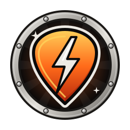
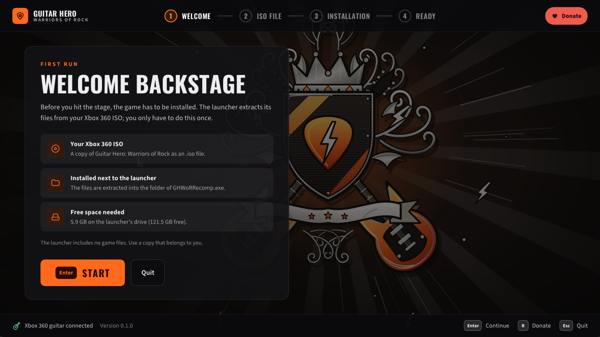
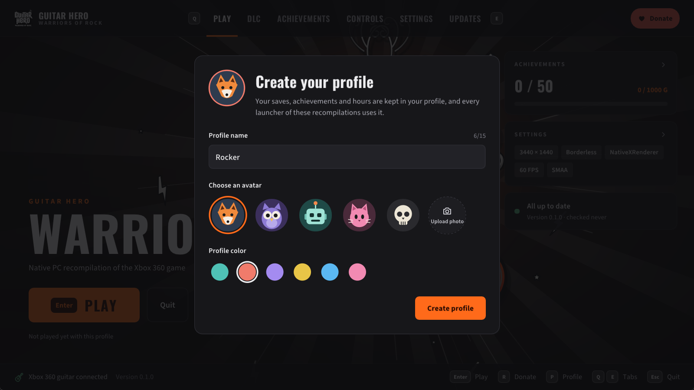
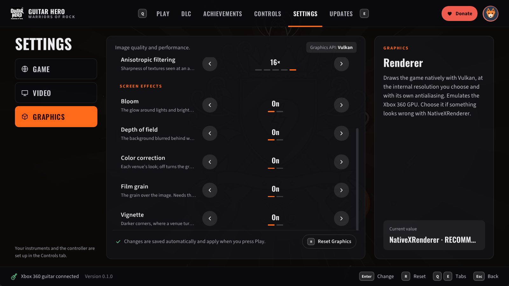
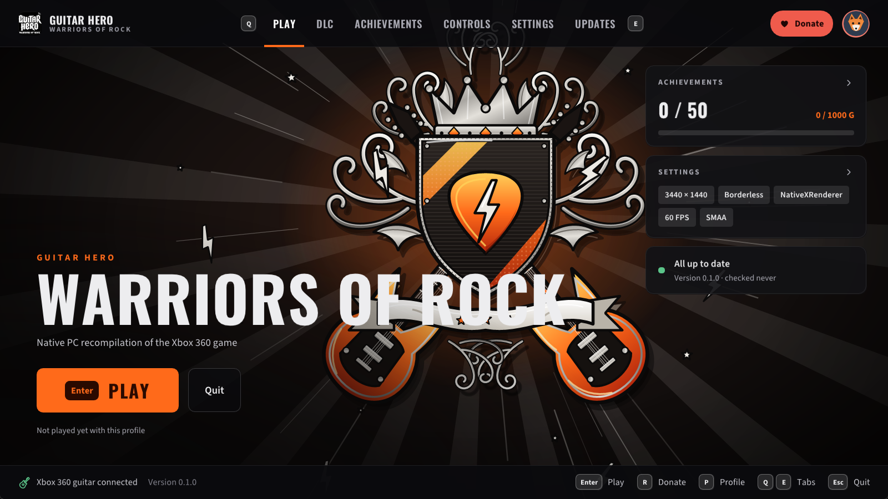
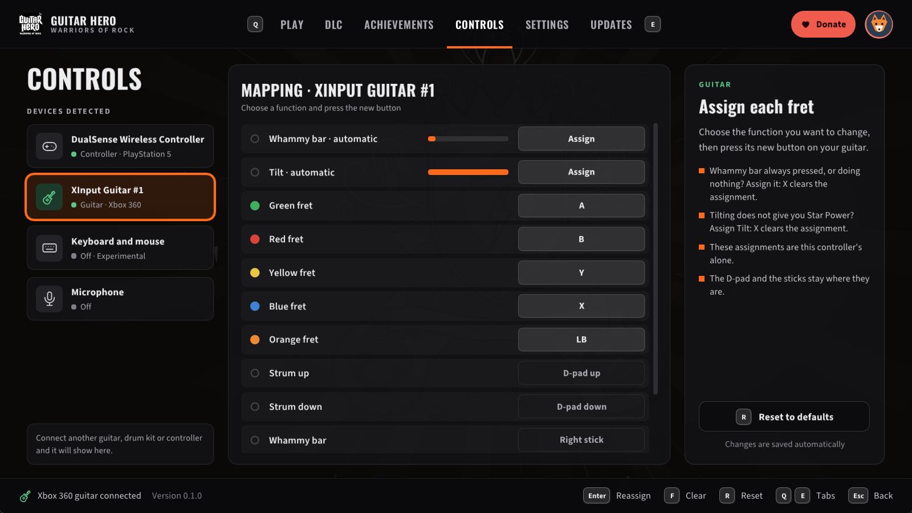
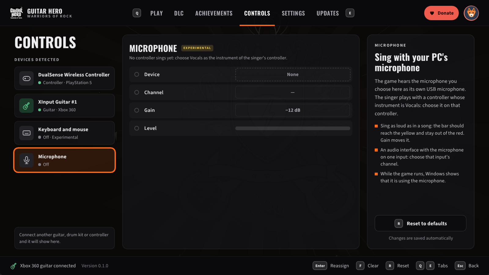
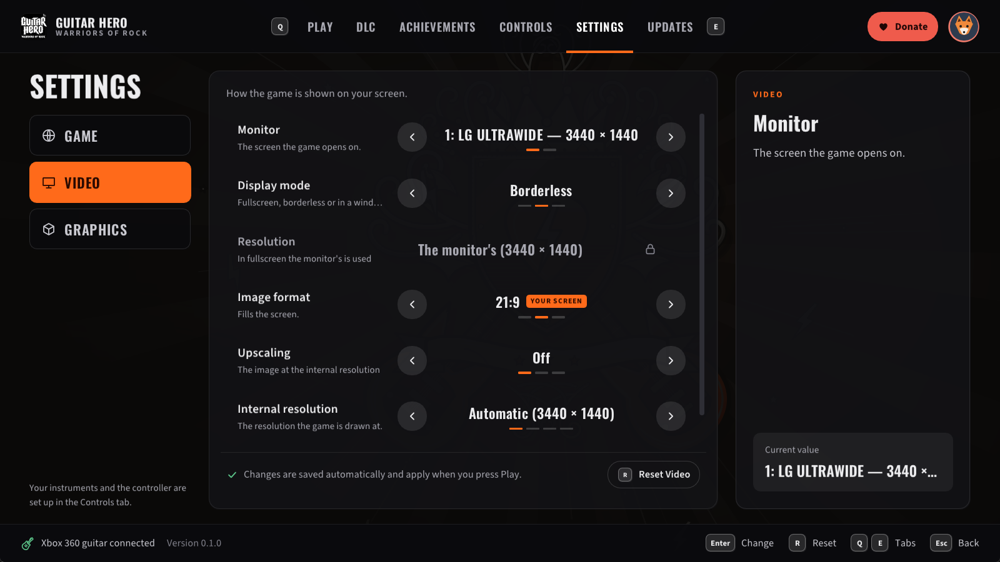
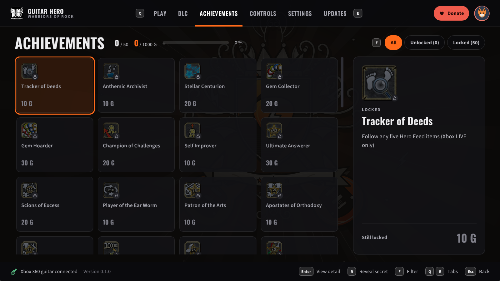
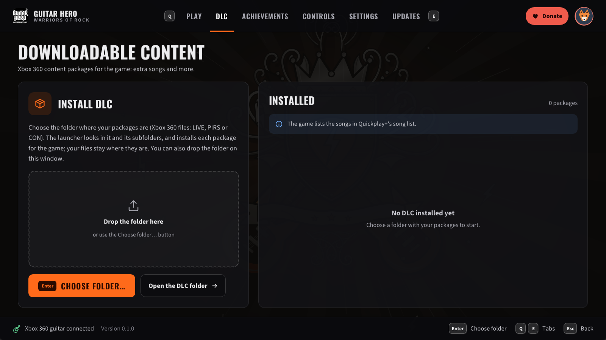

  

<h1 align="center">GHWoRRecomp</h1>

  
  
  
  
  

🎸 **Play Guitar Hero: Warriors of Rock on your PC, natively.** The Xbox 360 game (2010), recompiled to run directly on
Windows: no emulator to set up, sharp graphics, wide screens, high frame rates, and your Xbox 360 guitar.

> [!IMPORTANT]
> 💿 **You need your own original copy of the game.** This project does not include any of the game's files, and
> never will.
> - To play, you need an Xbox 360 copy of *Guitar Hero: Warriors of Rock* that you own (tested with the disc sold in
>   the USA).
> - You make an image (ISO) of your own disc, and the launcher installs the game from it.
> - Please do not ask for the game's files, and do not share them or links to them.
>
> This project is not affiliated with or endorsed by Microsoft, Activision or the game's developers.

> [!NOTE]
> 🤘 **Beta.** Songs have been played with an Xbox 360 guitar. Drums and singing have not been tested in this game yet.
> Guitar Hero: Warriors of Rock shares its engine with Guitar Hero 5, and what
> [GH5Recomp](https://github.com/ElGuslml/GH5Recomp), [GHVanHRecomp](https://github.com/ElGuslml/GHVanHRecomp) and
> [GHMetalRecomp](https://github.com/ElGuslml/GHMetalRecomp) fix and add is here too. If something goes wrong, please
> [tell us](#-reporting-a-problem)!

> [!WARNING]
> ⚠️ **Not tested yet:** AMD graphics cards (only in a simulation so far) and drum kits. If you play with either and
> something goes wrong, please report it in [issues](https://github.com/ElGuslml/GHWoRRecomp/issues) or on
> [Discord](https://discord.gg/XQtM5TmNs8).

## 🎮 How to play

1. **Download** the latest version from [Releases](https://github.com/ElGuslml/GHWoRRecomp/releases/latest):
   - **the installer** (`GHWoRRecomp-...-setup.exe`): installs for your Windows user, no administrator rights needed,
     with a Start menu shortcut; or
   - **the zip** (`GHWoRRecomp-...-win64.zip`): extract it into any folder you can write to (not `Program Files`).
2. **Open GH Warriors of Rock Launcher.** The first time, it asks for the ISO of your game, checks it and installs the
   game files (about 5.9 GB), then asks you to create your profile. You only do this once.
3. **Pick your settings and press PLAY.** 🎉
4. **Calibrate:** in the game's options, run the audio and video calibration once, so that the notes match what you
   hear on your own speakers or headphones.

  
  

The first run: the launcher checks your ISO, installs the game from it, and asks for your profile.

From then on, the launcher keeps itself up to date: when a new version comes out, it offers to install it for you.

### 💻 What you need

- Windows 10 or 11 (64-bit).
- A graphics card with up-to-date drivers that support Vulkan (practically any card from the last ten years).
- The [Microsoft Visual C++ Redistributable](https://aka.ms/vs/17/release/vc_redist.x64.exe) (most PCs already
  have it).
- An Xbox 360 guitar. Any other controller works as a guitar too, and so does the keyboard.
- To sing (experimental): any microphone connected to the PC, and a controller for the singer.

## ✨ Features

- 🎸 **Your guitar:** an Xbox 360 guitar plays as on the console, whammy bar and Star Power included. Any other
  controller is a guitar too, and the keyboard can be one (experimental: turn it on in the launcher's Keyboard page;
  frets on D F J K L). Each controller's buttons can be reassigned in the launcher, and a whammy bar that reads
  pressed at rest or does nothing, or a tilt that gives no Star Power (some third-party guitars), can be assigned there.
- 🎮 **Auto-strum, GH2 / GH3 style:** on a controller or the keyboard, each fret strums as you press it, so you play
  with the frets alone (a chord is one strum). Turn it on in the launcher's Controls tab; it only acts during a song,
  so the menus work as usual. The whammy bar is the right stick, pushed to either side.
- 🎤 **Sing (experimental):** any microphone on your PC is the game's USB microphone. Choose it in the launcher, and
  choose which controller sings.
- 🖥️ **Sharp, native graphics:** the game is drawn by your graphics card at your screen's resolution, with smooth
  edges (antialiasing) and sharper textures.
- 🚀 **No first-time stutters:** "Compiling shaders" prepares every graphics combination the game uses for your
  graphics card before you play, in a moment, only the first time and after an update.
- 🔍 **Upscaling:** AMD FSR 1 or NVIDIA NIS, on any graphics card, with their quality and sharpness: for a 4K screen
  or a slower graphics card ([how they compare](https://github.com/ElGuslml/GHMetalRecomp/blob/main/docs/scaling.md)).
- ⚡ **High frame rates:** 60 FPS as on the console, or 120, 144, 160, 165 or 240 FPS if your monitor supports it
  (experimental). The songs keep their speed and stay in sync. V-Sync is on by default (no tearing, the game in step
  with your monitor, without V-Sync's usual delay); leave it on with a G-Sync or FreeSync monitor too.
- 🔊 **Low latency audio:** optional, in the launcher's Settings: the game takes your audio device in exclusive mode,
  and the sound comes up to about 55 ms sooner (measured in GHMetalRecomp on a USB audio interface).
- 📺 **Wide and ultrawide screens:** the stage fills 16:9, 21:9 and wider screens, while the note highway, the HUD and
  the menus keep their shape in the center.
- 👤 **Profiles:** your saves, achievements and playtime in a profile shared by all the ElGus Recomps launchers.
- 👥 **Play together:** the first controller to press a button plays with your profile; the other controllers join as
  its guests, as on the Xbox 360.
- 🎶 **Downloadable content:** install your own packages from the launcher's DLC tab; Guitar Hero 5's add their songs
  to the game's list too ([what to expect](docs/dlc.md)).
- 🏆 **Achievements:** a notification when you unlock one, and all 50 in the launcher or with F7 in the game.
- 🌍 **Languages:** English, French, German, Italian and Spanish, in the game and in the launcher.
- 🔄 **Automatic updates** from this page.

## 🔧 Better than the original

Some problems come from the game itself and happen on an Xbox 360 too. They are fixed here, and each fix can be turned
off (the [notes](docs/README.md) say how):

- ⏱️ **Songs drifting out of sync.** On the later Xbox 360 models the music slowly falls behind the notes during a
  song, until you pause: the game corrects its clock for the first consoles' timer, which runs 0.25 % slow, and the
  later ones' does not. Here the game's clock runs at the right rate, and whole songs stay in sync
  ([details](docs/fixes-from-gh5.md#the-audio-drifts-out-of-sync-during-a-song)).
- 🎛️ **Screen effects you can turn off.** Bloom, depth of field, film grain, color correction and vignette each have
  a switch in the launcher's **Settings → Graphics** (all on by default, as on the console; with the color correction
  off, the grain is off too) ([details](docs/fixes-from-gh5.md#turning-off-the-screen-effects)).

  

## 🧭 GH Warriors of Rock Launcher

Everything is set up from **GH Warriors of Rock Launcher**, with the mouse, the keyboard or a controller:

  

| Tab | What you find there |
|---|---|
| ▶️ **Play** | Start the game, and see your settings, achievements and updates at a glance. |
| 🎶 **DLC** | Install your own downloadable content from a folder, and see the installed packages. |
| 🏆 **Achievements** | All 50 achievements, the ones you have unlocked and when. |
| 🎮 **Controls** | Your guitars, controllers and keyboard: what each button or key does, and which controller sings. The keyboard as a guitar (experimental). Frets that strum as you press them, on a controller or the keyboard. A whammy bar's and a tilt's assignment. Your microphone (experimental): device, gain and level. |
| ⚙️ **Settings** | **Game:** the game's and the launcher's language, Low latency audio. **Video:** monitor, fullscreen or window, resolution, image format (fill a wide screen or keep 16:9), upscaling (AMD FSR 1, NVIDIA NIS) and sharpness, V-Sync (on by default: no tearing, without V-Sync's usual delay; leave it on with a G-Sync or FreeSync monitor too). **Graphics:** renderer, frame rate, antialiasing, texture sharpness, the game's screen effects. |
| 🔄 **Updates** | Your version, and new ones when they come out. |
| 👤 **Profile** | Your picture at the top right: hours played, streaks, your week, your games and your favorite achievements. |

  
  

Controls: what each fret of your guitar does, and the microphone you sing with.

  
  

Settings (Video: your screen, window or fullscreen, the image format, upscaling) and the achievements.

  

Your choices are saved as soon as you make them. When you quit the game, the launcher comes back.

**Tips:**
- 🎤 **To sing:** in **Controls → Microphone**, choose your microphone and sing as loud as in a song: the level bar
  should reach the yellow without touching the red (change **Gain** if not). Then choose the singer's controller and
  set its **Instrument** to **Vocals**. Headphones help: with speakers, the microphone hears the song too.
- 🚪 In the main menu, press **B** (the red fret) to quit the game.
- 🎮 **Steam Big Picture:** add `GH Warriors of Rock Launcher.exe` as a non-Steam game and play from your couch.
- 🛡️ **"Windows protected your PC":** the programs are not signed by a company, so Windows may warn you the first
  time. Click **More info**, then **Run anyway**.

## 🐞 Reporting a problem

Something looks wrong, sounds wrong, or crashes? Tell us on [Discord](https://discord.gg/XQtM5TmNs8) or open an
[issue](https://github.com/ElGuslml/GHWoRRecomp/issues), with:
- where in the game it happened, and a screenshot if you can;
- the latest files in the `logs` folder next to the game: `ghwor_NNN.log`, and if the launcher misbehaved,
  `launcher_NNN.log` (with its `.dmp` file if there is one).

If something looks wrong, try the other renderer: in the launcher, **Graphics → Xenos** (it emulates the Xbox 360's
graphics instead), and tell us whether it happens there too.

### Known issues

- 🥁 Drums and singing have not been tested in this game yet.
- 🎤 Singing is experimental: if the pitch line jumps around, lower the microphone's **Gain** in the launcher; if the
  game does not hear you, raise it. While a microphone is chosen, Windows shows that the game is using it.
- ⌨️ Playing with the keyboard is experimental.
- 🔊 Some USB audio interfaces add delay in Windows' shared audio mode (a Focusrite Scarlett about 20 ms more than
  a motherboard's audio): calibrate the audio in the game's options.
- ⚡ Above 60 FPS is experimental: something may still run too fast.
- 🎶 Downloadable content: only a Guitar Hero 5 package has been tried so far (its songs show up in Quickplay+);
  Warriors of Rock's own packages have not been tried yet ([details](docs/dlc.md)).
- ✨ With the Xenos renderer, or if you skip "Compiling shaders", the first time an effect appears it may show up a
  moment late.

## ❤️ Support

If you enjoy rocking out to Warriors of Rock on your PC, you can support the work on [Ko-fi](https://ko-fi.com/elguslml) ☕.
For news about the next updates, follow [@ElGuslml on X](https://x.com/ElGuslml) and join the
[Discord](https://discord.gg/XQtM5TmNs8). And if you'd like more Xbox 360 classics running natively, the other
recompiled games are at [ElGus Recomps](https://github.com/ElGuslml/ElGusRecomps).

## 🛠️ For developers

GHWoRRecomp is a *static recompilation*: the game's original Xbox 360 code is translated to C++ and compiled for
Windows, on top of the [ReXGlue SDK](https://github.com/rexglue/rexglue-sdk). It is drawn by
[NativeXRenderer](https://github.com/ElGuslml/NativeXRenderer), a renderer that draws the game's graphics calls
natively on Vulkan.

- [Building and developing](docs/development.md): requirements, building from source, configuration, how the SDK is
  modified.
- [`docs/`](docs/README.md): a short note on each problem found and how it was solved.

## 🚧 In the works

New features on the way:
- 🌐 **Online multiplayer:** play with your friends over the internet.
- 🥁 **MIDI drum kits:** play the drums on an electronic drum kit connected to your PC.
- 💿 **Guitar Hero: World Tour DLC:** import your World Tour songs and play them here.
- 🎵 **Custom songs:** play songs made by the community.
- 🐧 **Linux and Steam Deck:** a port to play there too.
- ✨ **And more...**

Follow along on [Discord](https://discord.gg/XQtM5TmNs8) and on [X](https://x.com/ElGuslml).

## 🤖 A note about AI

This project is developed with the help of AI ([Claude](https://claude.ai), by Anthropic). I know it's a touchy
subject for many people, so I want to be open about it and explain how the work is done:

- 🎮 **The game is still the original game.** Its code is translated by the ReXGlue recompiler, not written by an
  AI, so it plays as it did on the Xbox 360: the same songs, the same charts, the same scoring.
- 🧪 **Every change is tested by hand.** I play each fix and improvement myself, with an Xbox 360 guitar, before it
  is released, and check it against how the game behaves on the console: the notes in time with the music, its
  graphics, its sound and how it feels to play.
- ⚡ **Performance is measured, not guessed.** CPU use, frame times, GPU time and the sync between the notes and the
  music are measured on real hardware before and after each change, so that the game runs smoothly and doesn't
  waste your computer's resources.
- 🙌 **Claude helps with the research and the code;** the decisions, the testing and the care for the game are mine.

If something doesn't run as well as it should, it's a bug like any other: tell us on
[Discord](https://discord.gg/XQtM5TmNs8) or open an [issue](https://github.com/ElGuslml/GHWoRRecomp/issues), and
it will get fixed. Thanks for giving this game a try! 🧡

## 🙏 Credits

- [ReXGlue SDK](https://github.com/rexglue/rexglue-sdk), whose runtime is derived from [Xenia](https://xenia.jp).
- [GH5Recomp](https://github.com/ElGuslml/GH5Recomp), [GHVanHRecomp](https://github.com/ElGuslml/GHVanHRecomp) and
  [GHMetalRecomp](https://github.com/ElGuslml/GHMetalRecomp), whose fixes this game shares.
- [extract-xiso](https://github.com/XboxDev/extract-xiso), for extracting game files.
- Developed by Gustavo Garcia with the help of Claude (Anthropic): see [the note about AI](#-a-note-about-ai).

## 📜 License

MIT for this project's own code (see [`LICENSE`](LICENSE)). The ReXGlue SDK and the other components keep their
own licenses (see [`THIRD_PARTY_NOTICES.md`](THIRD_PARTY_NOTICES.md)). Guitar Hero: Warriors of Rock, its code and
its assets belong to their respective owners.
