

  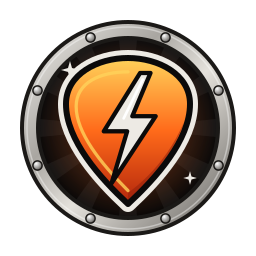

<h1 align="center">GHWoRRecomp</h1>

  
  

  
  
  
  
  

🎸 **Play Guitar Hero: Warriors of Rock on your PC, natively.** The Xbox 360 game (2010), recompiled to run directly on
Windows: no emulator to set up, sharp graphics, wide screens, high frame rates, and your Xbox 360 guitar.

> [!IMPORTANT]
> 💿 **You need your own original copy of the game.** This project does not include any of the game's files, and
> never will.
> - To play, you need an Xbox 360 copy of *Guitar Hero: Warriors of Rock* that you own (tested with the disc sold in
>   the USA).
> - You make an image (ISO) of your own disc, and the launcher installs the game from it.
> - Please do not ask for the game's files, and do not share them or links to them.
>
> This project is not affiliated with or endorsed by Microsoft, Activision or the game's developers.

> [!NOTE]
> 🤘 **Version 1.2.** Songs have been played on an Xbox 360 guitar, on drums and singing.
> Guitar Hero: Warriors of Rock shares its engine with Guitar Hero 5, and what
> [GH5Recomp](https://github.com/ElGuslml/GH5Recomp), [GHVanHRecomp](https://github.com/ElGuslml/GHVanHRecomp) and
> [GHMetalRecomp](https://github.com/ElGuslml/GHMetalRecomp) fix and add is here too. If something goes wrong, please
> [tell us](#-reporting-a-problem)!

> [!WARNING]
> ⚠️ **Not fully tested yet:** AMD and Intel graphics cards (AMD only in a simulation so far). If you play with one and
> something goes wrong, please report it in [issues](https://github.com/ElGuslml/GHWoRRecomp/issues) or on
> [Discord](https://discord.gg/XQtM5TmNs8).

## 🎮 How to play

1. **Download** the latest version from [Releases](https://github.com/ElGuslml/GHWoRRecomp/releases/latest):
   - **the installer** (`GHWoRRecomp-...-setup.exe`): installs for your Windows user, no administrator rights needed,
     with a Start menu shortcut; or
   - **the zip** (`GHWoRRecomp-...-win64.zip`): extract it into any folder you can write to (not `Program Files`).
2. **Open GH Warriors of Rock Launcher.** The first time, it asks for the ISO of your game, checks it and installs the
   game files (about 5.9 GB), then asks you to create your profile. You only do this once.
3. **Pick your settings and press PLAY.** 🎉
4. **Calibrate:** in the game's options, run the audio and video calibration once, so that the notes match what you
   hear on your own speakers or headphones.

  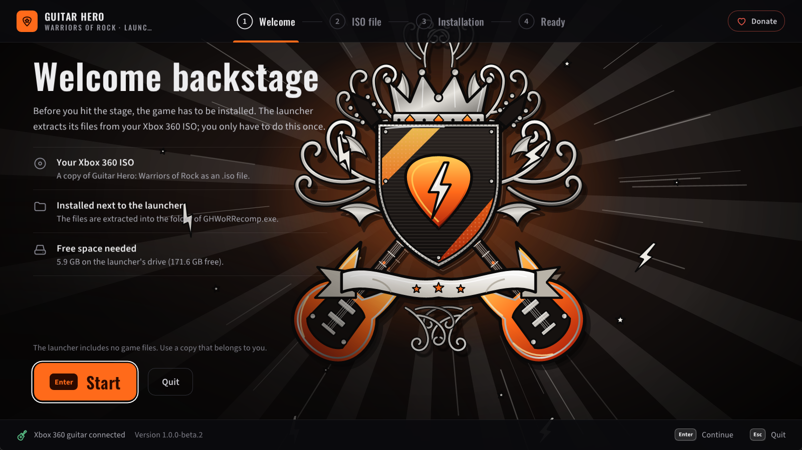
  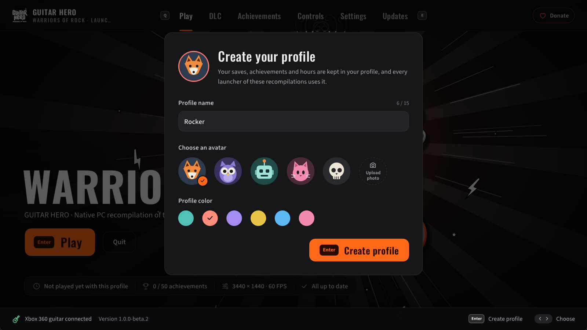

The first run: the launcher checks your ISO, installs the game from it, and asks for your profile.

From then on, the launcher keeps itself up to date: when a new version comes out, it offers to install it for you.

### 💻 What you need

- Windows 10 or 11 (64-bit).
- A graphics card with up-to-date drivers that support Vulkan (practically any card from the last ten years).
- The [Microsoft Visual C++ Redistributable](https://aka.ms/vs/17/release/vc_redist.x64.exe) (most PCs already
  have it).
- An Xbox 360 guitar, or an Xbox One guitar (through Microsoft GameInput, which the installer and the launcher offer
  to install). Any other controller works as a guitar too, and so does the keyboard.
- To sing: any microphone connected to the PC, and a controller for the singer.

## ✨ Features

- 🎸 **Your guitar:** an Xbox 360 guitar plays as on the console, whammy bar and Star Power included. Any other
  controller is a guitar too, and the keyboard can be one (its page in the launcher's Controls tab;
  frets on D F J K L). Each controller's buttons can be reassigned in the launcher, and a whammy bar that reads
  pressed at rest or does nothing, or a tilt that gives no Star Power (some third-party guitars), can be assigned there.
- 🎮 **A controller plays as in Guitar Hero III:** in a song the frets are LT, LB, RB, RT and A (B the bass's open
  note), and there is no strum: pressing a fret plays its note. The game plays it with Guitar Hero III's own controller
  code, still inside Warriors of Rock. Star Power is on the D-pad or Back, and the whammy bar on either stick. Its
  buttons in a song are its own (the launcher's **In a song**: each fret, the open note, Star Power and the whammy bar on
  up to two buttons), apart from the menus' (**Navigation**). It is the default **Play style**; each controller's page
  in the launcher's Controls tab can choose **Guitar · Xbox 360** instead, for a guitar that Windows sees as a
  controller (through an adapter), while another controller keeps this one. **The keyboard plays the same way** by
  default (the fret keys D, F, J, K and L, the open note on 3, Star Power on Space, the whammy bar on the right arrow);
  its Keyboard page's **Play style** can choose **Guitar · Xbox 360** instead (strum with the arrows).
- 🎸 **Xbox One guitars:** the PDP Riffmaster and Jaguar, the Mad Catz Stratocaster and the CRKD / RedOctane Stage
  Tour play through Microsoft GameInput, their tilt included. The installer and the launcher offer to install GameInput
  if your PC lacks it ([details](docs/xbox-one-guitars.md)).
- 🥁 **Drum kits on five or four lanes:** a Guitar Hero kit, a PlayStation kit through a MIDI Pro Adapter, a Rock Band
  kit, a controller or the keyboard as drums, on five or four lanes as you choose in the launcher's **Controls** tab.
- 🎤 **Sing:** any microphone on your PC is the game's USB microphone. Choose it in the launcher, and
  choose which controller sings.
- 🖥️ **Sharp, native graphics:** the game is drawn by your graphics card at your screen's resolution, with smooth
  edges (antialiasing) and sharper textures.
- 🚀 **No first-time stutters:** "Compiling shaders" prepares every graphics combination the game uses for your
  graphics card before you play, in a moment, only the first time and after an update.
- 🔍 **Upscaling:** AMD FSR 1 or NVIDIA NIS, on any graphics card, with their quality and sharpness: for a 4K screen
  or a slower graphics card ([how they compare](https://github.com/ElGuslml/GHMetalRecomp/blob/main/docs/scaling.md)).
  They, or a lower internal resolution, can go down to 540, 480 or 360 lines. Either the stage, the band and the
  crowd alone are drawn smaller, with the note highway, the HUD and the menus kept sharp at the screen's resolution;
  or the whole image is drawn smaller, the lightest for the graphics card.
- 🧠 **DLSS, DLAA and FSR 3.1:** NVIDIA DLSS and DLAA (on an RTX card) and AMD FSR 3.1 rebuild the 3D from several
  frames, in step with the way the game draws its stage over two frames: as smooth as on the console, no ghosting on
  the band, and a clean start at every camera cut. DLSS comes with NVIDIA's DLSS 310.9.16 and lets you choose its
  Transformer model, Transformer K (the first Transformer model in every mode, lighter in Performance and Ultra
  Performance) or the lighter CNN. *(By [Panchovix](https://github.com/Panchovix).)*
- 🏎️ **Faster with an upscaler (optional):** two switches in **Settings → Graphics**, under Upscaling, for slower graphics cards, off by
  default. **Screen effects before the upscaler** draws the glow around lights and the blurred backgrounds at the
  upscaler's resolution: much less work for the graphics card (an RTX A2000 at 4K with DLSS Performance went from 113 to
  130 FPS), with a slightly softer glow and blur. **Even frame times with DLSS** (DLSS upscaling, not DLAA) moves DLSS's
  work to the start of the next frame, so that every frame takes about the same time; the stage shows a pair of frames
  later, while the note highway and the HUD are not delayed. *(By [Panchovix](https://github.com/Panchovix).)*
- 🌑 **Sharper shadows:** the **Shadow quality** row draws the shadows at up to four times the original resolution.
- 🌗 **Ambient occlusion:** soft shadows in the corners, the folds and where the band touches the stage (XeGTAO, Low to
  Ultra), in place of the game's own; **Texture detail** sharpens the venue's textures.
- ⚡ **High frame rates:** 60 FPS as on the console, or 72, 75, 90, 100, 120, 144, 160, 165 or 240 FPS if your monitor supports it
  (experimental), and 300, 360, 480 or Unlimited with V-Sync off (experimental: with V-Sync on the game runs at your
  monitor's rate). The songs keep their speed and stay in sync. V-Sync is on by default (no tearing, the game in step
  with your monitor, without V-Sync's usual delay); leave it on with a G-Sync or FreeSync monitor too. Star Power
  answers every press of Back (Select) or the D-pad at any frame rate. *(Star Power fix by
  [Panchovix](https://github.com/Panchovix).)* The game draws its stage at half your frame rate, as on the console;
  **Venue at the full frame rate** (**Settings → Display**, off by default) draws it every frame.
- 🪶 **Light on your PC:** the renderer records the graphics card's work on a thread of its own, compiles each shader
  for its draw's textures (about a fifth less work for the graphics card, the same image) and skips data the game
  marks without changing it. In a busy song at 3440x1440 with the venue at the full frame rate, an i7-13700K holds
  160 and 240 FPS; on a four-core processor 60 and 120 FPS hold too.
- 🎞️ **Steady frame times:** in menus and videos, after a hitch (a loading, a stall), and in a window with V-Sync,
  which shows every frame.
- 🎵 **The music in time with the notes:** a song that follows another (a chapter's next part, a playlist's next song)
  starts with its music, and the notes do not drift from the music during a song, at any frame rate
  ([details](docs/song-sync.md)).
- 🔊 **Low latency audio:** optional, in the launcher's Settings: the game takes your audio device in exclusive mode,
  and the sound comes up to about 55 ms sooner (measured in GHMetalRecomp on a USB audio interface).
- 🔉 **5.1 or stereo:** **Settings → Audio → Channels** (Automatic, 5.1, Stereo or Mono) tells the game your
  speakers; the notes' timing stays the same with each, so you do not need to calibrate again.
- 🔈 **Louder when you need it:** the volume goes up to 200 % in **Settings → Audio**, for a game that sounds quiet next
  to the rest of your PC (above 100 % its loudest moments can distort). *(By [Panchovix](https://github.com/Panchovix).)*
- 🌟 **World Tour's Star Power sound (optional):** while your Star Power is on, your instrument goes through Guitar
  Hero World Tour's echo, timed to the song, and its reverb, as it did in that game. A switch in the launcher's **Mods** tab,
  off by default. *(By [Panchovix](https://github.com/Panchovix).)*
- 🛣️ **Your note highway (optional):** in the launcher's **Mods** tab: your own pictures on the highway, from a
  gallery of your folder with favorites, one picture or a random one at each song, bright ones darkened so that the
  notes stand out, all previewed with the game's own highway (read from your game files). The highway smaller or
  larger when you play alone (80-120 %), longer so that the notes show up earlier at the same speed, as in Clone Hero
  (up to 170 %, the highway continued in its own perspective), its perspective flatter or steeper (with the notes at
  the console's speed if you want), the community's black highway, each of the note effects (the burst on a hit, Star Power's blue one, a sustain's sparks, the open note's wave) hidden if you want, and the crowd hidden during songs. In **Mods → Sound**, the whammy bar's sound effect, and how much of your
  instrument stays when you miss a note (0-100 %; the console mutes it). All as on the console by default.
- 🎯 **Improved gameplay (optional):** two choices in the launcher's **Mods → Gameplay**, both off by default,
  as on the console. **Infinite front-end:** a hammer-on, pull-off or tap note fretted before it reaches the hit window
  counts as soon as it enters it (a missed note or an overstrum clears it, so you fret again). **Sustain drop
  leniency** (5 to 200 ms): a long note's fret let go a moment early to reach the next note, or lifted for an instant,
  does not drop the sustain.
- 🖼️ **Custom textures:** put an image named by a texture's hash in the `textures` folder next to the game and it
  replaces that texture (with NativeXRenderer); the note highway's is `38E266C86DB5FC0C`. The game can log and dump
  its textures by hash to find the others. The highway can also be made see-through (**Mods → Highway**, Highway
  opacity).
- 📦 **Mod packs (optional):** the community's mods in the launcher's **Mods → Packs**: add a mod's `.zip` (or its
  folder), switch it on, and the game reads its files in place of its own without changing them. A mod made of patches
  is prepared once from your own game files; Delete removes a mod. *(By [Panchovix](https://github.com/Panchovix).)*
- 📺 **Wide and ultrawide screens:** the stage fills 16:9, 21:9 and wider screens, while the note highway, the HUD and
  the menus keep their shape in the center.
- 👤 **Profiles:** your saves, achievements and playtime in a profile shared by all the ElGus Recomps launchers.
- 👥 **Play together:** the first controller to press a button plays with your profile; the other controllers join as
  its guests, as on the Xbox 360.
- 🌐 **Online with your friends (experimental):** the game's online modes through Steam, without Xbox Live: invite your
  Steam friends who have the game open from the band lobby's friends list, or from Steam
  ([how it works](docs/online-play.md)).
- 🎶 **Downloadable content:** point the launcher's DLC tab at the folder where you keep your Xbox 360 packages: the
  game reads them from there (nothing is copied, and the other ElGus Recomps launchers can use the same folder),
  Guitar Hero 5's add their songs to the game's list too, and packages the game cannot read come turned off
  ([what to expect](docs/dlc.md)).
- 🏆 **Achievements:** a notification when you unlock one, and all 50 in the launcher or with F7 in the game.
- 🌍 **Languages:** English, French, German, Italian and Spanish, in the game and in the launcher.
- 🔄 **Automatic updates** from this page.

## 🔧 Better than the original

Some problems come from the game itself and happen on an Xbox 360 too. They are fixed here, and each fix can be turned
off (the [notes](docs/README.md) say how):

- ⏱️ **Songs drifting out of sync.** On the later Xbox 360 models the music slowly falls behind the notes during a
  song, until you pause: the game corrects its clock for the first consoles' timer, which runs 0.25 % slow, and the
  later ones' does not. Here the game's clock runs at the right rate, and whole songs stay in sync
  ([details](docs/fixes-from-gh5.md#the-audio-drifts-out-of-sync-during-a-song)).
- 🎛️ **Screen effects you can turn off.** Bloom, depth of field, film grain, color correction and vignette each have
  a switch in the launcher's **Settings → Effects** (all on by default, as on the console; with the color correction
  off, the grain is off too) ([details](docs/fixes-from-gh5.md#turning-off-the-screen-effects)).

  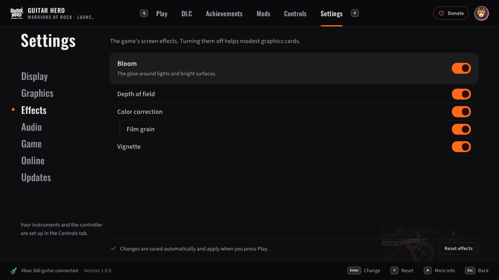

## 🧭 GH Warriors of Rock Launcher

Everything is set up from **GH Warriors of Rock Launcher**, with the mouse, the keyboard or a controller:

  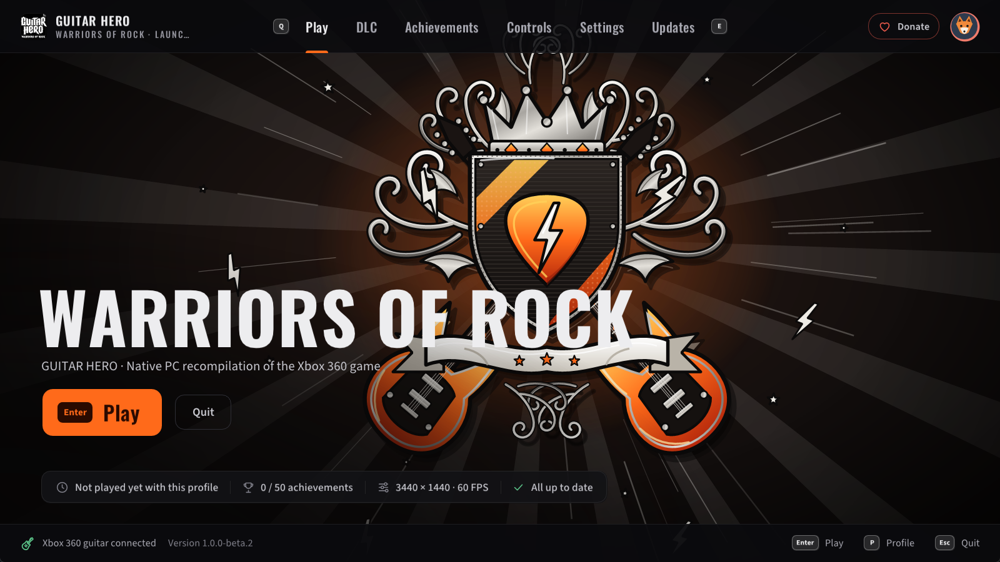

| Tab | What you find there |
|---|---|
| ▶️ **Play** | Start the game, see your settings and achievements at a glance, and a new version when there is one. |
| 🎶 **DLC** | Your DLC folder: the game reads your packages from there, nothing copied. They are grouped by the game they were made for, each with its switch. |
| 🏆 **Achievements** | All 50 achievements, the ones you have unlocked and when. |
| 🧩 **Mods** | **Highway:** your pictures for the note highway (a gallery with favorites, one picture or a random one at each song, bright ones darkened), previewed with the game's own highway; its scale with one player, its length (the notes seen earlier at the same speed), perspective (the notes at the console's speed with it, if you want), style (original or dark) and opacity; the note effects, each with a switch. **Gameplay:** infinite front-end for HOPOs and taps, sustain drop leniency (0-200 ms). **Stage:** the crowd. **Sound:** the whammy's sound effect, World Tour's Star Power sound, the instrument's volume on a miss. **Tools:** the game's own debug menu, the developer's keys. **Packs:** the mods you add from a `.zip` or a folder, each with its switch, and Delete. |
| 🎮 **Controls** | Your guitars, controllers and keyboard: what each button or key does, and which controller plays drums (five or four lanes) or sings. The keyboard as a guitar or a drum kit. Each controller's and the keyboard's **Play style**: as in Guitar Hero III (the default) or a guitar. Xbox One guitars, and GameInput to install when it is missing. A whammy bar's and a tilt's assignment. Your microphone: device, gain and level. |
| ⚙️ **Settings** | **Display:** monitor, fullscreen or window, resolution, image format (fill a wide screen or keep 16:9), frame rate, V-Sync (on by default: no tearing, without V-Sync's usual delay; leave it on with a G-Sync or FreeSync monitor too), the venue at the full frame rate (the console draws it at half the rate of the note highway). **Graphics:** renderer, graphics card, upscaling (AMD FSR 1, NVIDIA NIS, AMD FSR 3.1, NVIDIA DLSS with its Transformer, Transformer K or CNN model) with its quality and the internal resolution, two switches that make the upscalers faster (the screen effects before the upscaler, even frame times with DLSS upscaling), antialiasing (SMAA, FXAA or NVIDIA DLAA), sharpness, texture sharpness, shadow quality, ambient occlusion, texture detail (and extra texture detail with DLSS or FSR 3.1). **Effects:** the game's screen effects. **Audio:** output device, channels (Automatic, 5.1, Stereo, Mono; the notes' timing the same with each), volume (up to 200 %), mute in the background, Low latency audio. **Game:** the game's and the launcher's language, the intro videos shortened (the logos end once the game has loaded, no intro movie). **Online** (experimental): online play with your Steam friends. **Updates:** your version, and new ones when they come out (the betas too, if you choose); Play shows a new one. |
| 👤 **Profile** | Your picture at the top right: hours played, streaks, your week, your games and your favorite achievements. |

  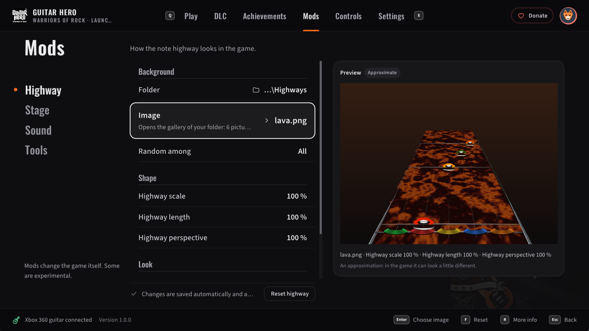
  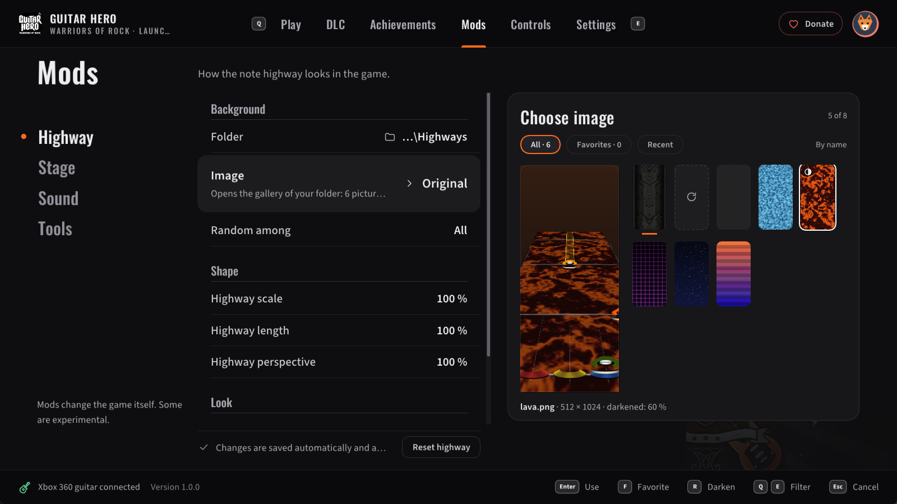

Mods: a picture of your own on the note highway, previewed with the game's own highway, and the gallery of your folder (favorites, darkening).

  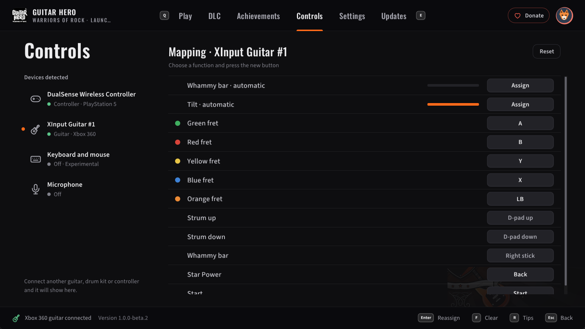
  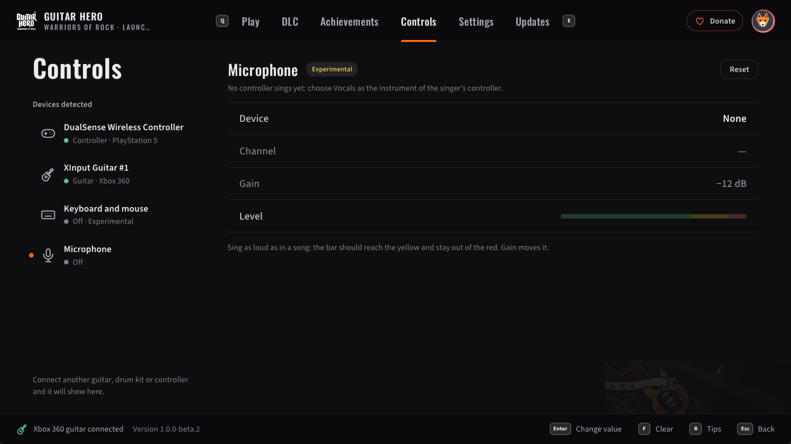

Controls: what each fret of your guitar does, and the microphone you sing with.

  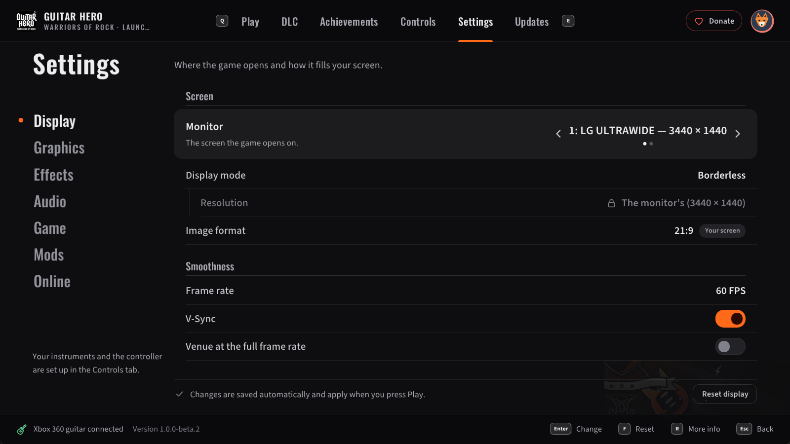
  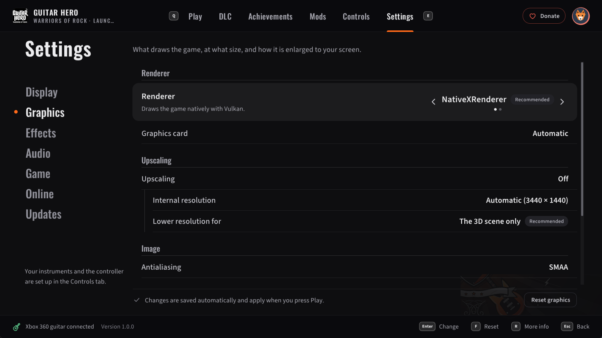

Settings: Display (your screen, window or fullscreen, the image format, the frame rate, V-Sync) and Graphics (the renderer, the graphics card, upscaling, antialiasing).

  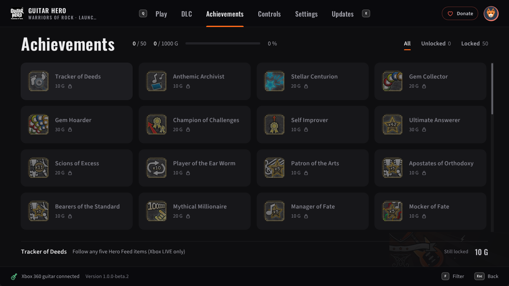
  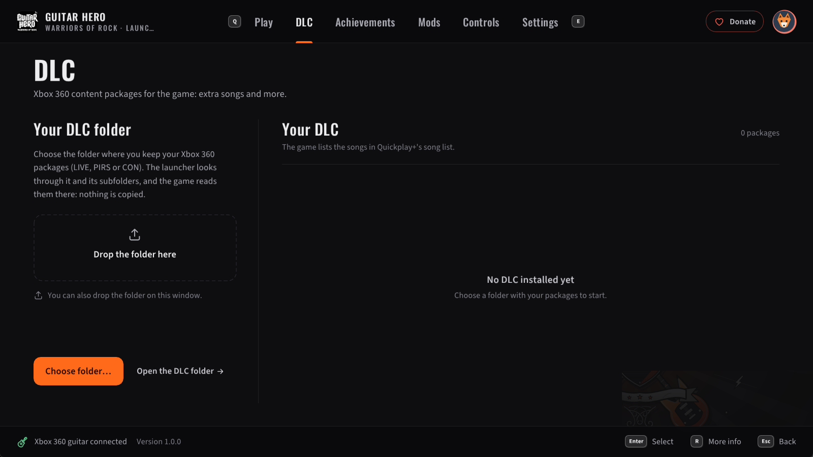

The 50 achievements, and your DLC folder.

Your choices are saved as soon as you make them. When you quit the game, the launcher comes back.

**Tips:**
- 🎤 **To sing:** in **Controls → Microphone**, choose your microphone and sing as loud as in a song: the level bar
  should reach the yellow without touching the red (change **Gain** if not). Then choose the singer's controller and
  set its **Instrument** to **Vocals**. Headphones help: with speakers, the microphone hears the song too.
- 🚪 In the main menu, press **B** (the red fret) to quit the game.
- 🎮 **Steam Big Picture:** add `GH Warriors of Rock Launcher.exe` as a non-Steam game and play from your couch.
- 🛡️ **"Windows protected your PC":** the programs are not signed by a company, so Windows may warn you the first
  time. Click **More info**, then **Run anyway**.

## 🐞 Reporting a problem

Something looks wrong, sounds wrong, or crashes? Tell us on [Discord](https://discord.gg/XQtM5TmNs8) or open an
[issue](https://github.com/ElGuslml/GHWoRRecomp/issues), with:
- where in the game it happened, and a screenshot if you can;
- the latest files in the `logs` folder next to the game: `ghwor_NNN.log`, and if the launcher misbehaved,
  `launcher_NNN.log` (with its `.dmp` file if there is one).

If something looks wrong, try the other renderer: in the launcher, **Graphics → Xenos** (it emulates the Xbox 360's
graphics instead), and tell us whether it happens there too.

### Known issues

- 🌐 The music store, leaderboards and Rock Record needed Activision's servers, which are gone.
- 🖼️ The highway's pictures, custom textures, ambient occlusion and texture detail need NativeXRenderer (the default
  renderer); with Xenos the game draws its own.
- 🛣️ With two to four players, a perspective other than 100 % and the notes at the console's speed on, the notes come
  a few percent faster than on the console (4-7 % at 75 %).
- 📺 A frame rate that is not a whole fraction of your monitor's refresh rate (90 FPS on a 144 Hz monitor, for
  example) looks uneven with V-Sync, unless your monitor has G-Sync or FreeSync.
- 🎨 AMD and Intel graphics cards have not been tried with this version: if something looks wrong, tell us.
- ⚡ Above 60 FPS is experimental: something may still run too fast. Above 240 FPS more so.
- 🎶 Downloadable content: Guitar Hero 5's packages add their songs to Quickplay+; Warriors of Rock's own packages and
  the community's are read, but their songs have not been played yet ([details](docs/dlc.md)). The community's
  custom songs need its **GH:WoR Customs Database** package in your DLC folder too: without it the number of songs
  can change from one start to the next.
- ✨ With the Xenos renderer, or if you skip "Compiling shaders", the first time an effect appears it may show up a
  moment late.

## ❤️ Support

If you enjoy rocking out to Warriors of Rock on your PC, you can support the work on [Ko-fi](https://ko-fi.com/elguslml) ☕.
For news about the next updates, follow [@ElGuslml on X](https://x.com/ElGuslml) and join the
[Discord](https://discord.gg/XQtM5TmNs8). And if you'd like more Xbox 360 classics running natively, the other
recompiled games are at [ElGus Recomps](https://github.com/ElGuslml/ElGusRecomps).

## 🛠️ For developers

GHWoRRecomp is a *static recompilation*: the game's original Xbox 360 code is translated to C++ and compiled for
Windows, on top of the [ReXGlue SDK](https://github.com/rexglue/rexglue-sdk). It is drawn by
[NativeXRenderer](https://github.com/ElGuslml/NativeXRenderer), a renderer that draws the game's graphics calls
natively on Vulkan.

- [Building and developing](docs/development.md): requirements, building from source, configuration, how the SDK is
  modified.
- [`docs/`](docs/README.md): a short note on each problem found and how it was solved.

## 🚧 In the works

New features on the way:
- 🥁 **MIDI drum kits:** play the drums on an electronic drum kit connected to your PC.
- 💿 **Guitar Hero: World Tour DLC:** import your World Tour songs and play them here.
- 🎵 **Custom songs:** play songs made by the community.
- 🐧 **Linux and Steam Deck:** a port to play there too.
- ✨ **And more...**

Follow along on [Discord](https://discord.gg/XQtM5TmNs8) and on [X](https://x.com/ElGuslml).

## 🤖 A note about AI

This project is developed with the help of AI ([Claude](https://claude.ai), by Anthropic). I know it's a touchy
subject for many people, so I want to be open about it and explain how the work is done:

- 🎮 **The game is still the original game.** Its code is translated by the ReXGlue recompiler, not written by an
  AI, so it plays as it did on the Xbox 360: the same songs, the same charts, the same scoring.
- 🧪 **Every change is tested by hand.** I play each fix and improvement myself, with an Xbox 360 guitar, before it
  is released, and check it against how the game behaves on the console: the notes in time with the music, its
  graphics, its sound and how it feels to play.
- ⚡ **Performance is measured, not guessed.** CPU use, frame times, GPU time and the sync between the notes and the
  music are measured on real hardware before and after each change, so that the game runs smoothly and doesn't
  waste your computer's resources.
- 🙌 **Claude helps with the research and the code;** the decisions, the testing and the care for the game are mine.

If something doesn't run as well as it should, it's a bug like any other: tell us on
[Discord](https://discord.gg/XQtM5TmNs8) or open an [issue](https://github.com/ElGuslml/GHWoRRecomp/issues), and
it will get fixed. Thanks for giving this game a try! 🧡

## 🙏 Credits

- [ReXGlue SDK](https://github.com/rexglue/rexglue-sdk), whose runtime is derived from [Xenia](https://xenia.jp).
- [GH5Recomp](https://github.com/ElGuslml/GH5Recomp), [GHVanHRecomp](https://github.com/ElGuslml/GHVanHRecomp) and
  [GHMetalRecomp](https://github.com/ElGuslml/GHMetalRecomp), whose fixes this game shares.
- [extract-xiso](https://github.com/XboxDev/extract-xiso), for extracting game files.
- [Panchovix](https://github.com/Panchovix), who contributed:
  - DLSS, DLAA and FSR 3.1 in step with the game's two-frame drawing, and DLSS's model choice;
  - the two switches that make them faster;
  - World Tour's Star Power sound;
  - the volume up to 200 %;
  - Star Power answering every press above 60 FPS;
  - mod packs: mods the game reads in place of its own files without changing them, added from a `.zip` in the
    launcher's **Mods** tab, each with its switch;
  - work on NativeXRenderer's speed (a one-pass present, per-pass GPU timings).
- [LuisText](https://github.com/LuisText), for contributions that made the game run faster.
- Developed by Gustavo Garcia with the help of Claude (Anthropic): see [the note about AI](#-a-note-about-ai).

## 📜 License

MIT for this project's own code (see [`LICENSE`](LICENSE)). The ReXGlue SDK and the other components keep their
own licenses (see [`THIRD_PARTY_NOTICES.md`](THIRD_PARTY_NOTICES.md)). Guitar Hero: Warriors of Rock, its code and
its assets belong to their respective owners.
